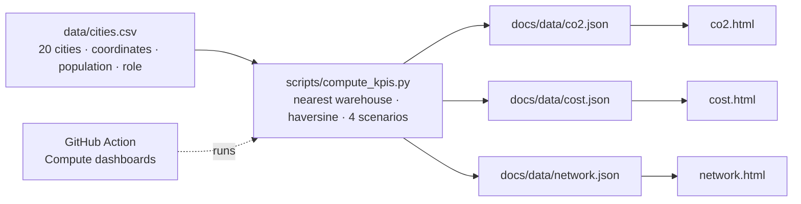

# Logistics network — three roles, three KPIs, three dashboards

**TD5 · Business Intelligence** — one logistics network (3 warehouses, 20 French
cities), seen by three people who make three different decisions, and therefore need
three different dashboards.

### [Open the dashboards](https://adam-hassen-bi.github.io/td-logistics-dashboards-TD5/)

https://adam-hassen-bi.github.io/td-logistics-dashboards-TD5/

| Dashboard | Who | Decision | Chart choice |
|---|---|---|---|
| [`co2.html`](https://adam-hassen-bi.github.io/td-logistics-dashboards-TD5/co2.html) | Sustainability / CSR manager | Which routes to prioritize for consolidation or rail shift? | Sorted bars (which route) + map of flows (where) |
| [`cost.html`](https://adam-hassen-bi.github.io/td-logistics-dashboards-TD5/cost.html) | Logistics / operations manager | Per warehouse, is the cost problem transport or storage? | Stacked bars, total ↔ per tonne + exact-figures table, **no map** |
| [`network.html`](https://adam-hassen-bi.github.io/td-logistics-dashboards-TD5/network.html) | Strategic / network planner | Open Bordeaux or Marseille, or close Lille? | Bars of discrete options + side-by-side maps + who-gains dumbbell |

---

## Pipeline



One dataset, one script, three KPI constructs:

| KPI | Formula |
|---|---|
| Demand (proxy) | population / 1000 × 50 t per year |
| CO₂ | distance × demand × 0.10 kg CO₂e per tonne-km |
| Transport cost | distance × demand × €0.12 per tonne-km |
| Storage cost | demand × €40 per tonne per year |
| Network coverage | population-weighted average distance to the serving warehouse |

Each city is served by its **nearest** warehouse (straight-line distance from real
coordinates).

## Results

| | Today (Paris, Lyon, Lille) | + Marseille | + Bordeaux | − Lille |
|---|---|---|---|---|
| Avg distance per resident | 168.0 km | **115.0 km** | 139.9 km | 174.4 km |
| Worst city | 436 km | 436 km | **382 km** | 436 km |
| CO₂ / year | 6,236 t | **4,269 t** | 5,192 t | 6,473 t |
| Transport cost / year | €7.48 M | **€5.12 M** | €6.23 M | €7.77 M |

- **Lille ships to no other city** (0 kg CO₂, €0 transport) and still should not be
  closed: its own market would then be served from Paris, 204 km away.
- **Lyon is the expensive warehouse** (€13.48 M, 60 % of cost) because of transport —
  €29.2/t vs €10.9/t at Paris — not storage, which is a flat €40/t everywhere.
- Under these assumptions the three managers **agree**: CO₂ and transport cost are both
  proportional to tonne-km. What the model leaves out (capex, fixed cost of a fourth
  site, lease exit) is where the real disagreement is — stated on the network page.

## What I added to the TD's version

- **CO₂ factor slider** across the cited 0.047–0.12 range: every CO₂ figure on the page
  follows, so the uncertainty of the main assumption is visible.
- **Per-tonne toggle** on the cost page: it shows storage is flat and transport is the
  lever specific to Lyon.
- **Tonne-weighted cost per tonne** (€60.16) instead of the TD's plain mean of the three
  warehouses (€53.37), which gave tiny Lille the same weight as Lyon.
- **Multi-objective table**: each scenario through the CO₂ and cost KPIs too.
- **Who gains, who loses** dumbbell chart (Step 15), for any of the three options.
- **Maps in SVG** with a latitude-corrected projection: plotting raw lon/lat as x/y
  stretches France ~45 % horizontally. `docs/js/france-map-background.js` keeps the
  TD's Chart.js plugin and adds `franceProjection()` — same principle: outline and
  points share one transform, so they never drift apart.
- Light / dark mode, mobile layout, tooltips everywhere, assumptions stated on every page.

## Run it

```bash
python3 scripts/compute_kpis.py   # no dependency beyond the standard library
python3 serve.py                  # http://localhost:8000
python3 serve.py --refresh        # recompute, then serve
```

On GitHub: **Actions → Compute dashboards → Run workflow** (manual only — the input
data does not change on its own, so there is nothing to schedule).

## Repository layout

```
data/cities.csv                       20 cities, coordinates, population, role
scripts/compute_kpis.py               the three KPI constructs + 4 network scenarios
docs/index.html                       landing page
docs/co2.html · cost.html · network.html
docs/css/style.css · docs/js/ui.js    shared styles and helpers
docs/js/france-map-background.js      real France outline (simplified) + projection
docs/js/map.js                        network map drawing, shared by two pages
docs/data/*.json                      generated by the workflow
.github/workflows/compute.yml
REFLECTIONS.md                        answers to the 7 TD questions
```

## Sources and limits

- CO₂ factor: French Ministry of Ecology road-freight guide (2018, ~0.047 kg CO₂e/t·km
  long-haul) and ADEME Base Carbone / Base Empreinte — check the current figure before
  citing 0.10.
- City populations: approximate municipal figures, to re-check against INSEE.
- France outline: [gregoiredavid/france-geojson](https://github.com/gregoiredavid/france-geojson)
  `metropole.geojson`, Etalab Open Licence, simplified to 219 points.
- Cost constants are **illustrative, not sourced**; demand is a **population proxy**;
  distances are straight lines (shorter than roads); no capex or fixed site cost.
